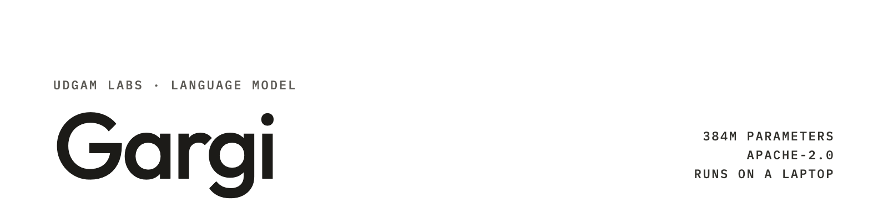

**UDGAM LABS** · Language model · 384M parameters

# Gargi

**Gargi is a 384M-parameter English language model trained from scratch by Udgam Labs on about 17 billion tokens: roughly
1,000× less training data than comparable open models such as Qwen2.5-0.5B.** It thinks step by step on maths
problems, reads up to about 16,000 tokens, and runs comfortably on a laptop or phone-class device.

> **Data efficiency:** on the same evaluation harness, Gargi's base model comes within **2 points** of Qwen2.5-0.5B on
> ARC-Easy, ARC-Challenge and WinoGrande (62.8 vs 64.7, 32.3 vs 32.4, 54.6 vs 56.1), although Qwen2.5-0.5B was
> trained on ~18 trillion tokens and Gargi on ~17 billion. See *Evaluation*.

Gargi is named after Gargi Vachaknavi, the Vedic philosopher remembered for asking the hardest questions.

| | |
|---|---|
| Parameters | 384M (Gemma 4-style decoder, sliding-window + global attention) |
| Training data | ≈17B tokens read in total, all openly licensed or public-domain text plus synthetic text from open models |
| Context | trained at 32K; **reliable recall up to ~16K tokens** (100% at 8K, 93% at 16K, 90% at 20K) |
| Modes | thinking on (step-by-step reasoning before the answer) or off |
| Languages | English |
| Licence | Apache-2.0 |
| Formats | safetensors (this repo), GGUF (Q8_0, Q4_K_M, f16), MLX (bf16, 4-bit) |

## Quick start

Weights are on Hugging Face: [Gargi](https://huggingface.co/udgamlabs/Gargi) (chat) · [Gargi-Base](https://huggingface.co/udgamlabs/Gargi-Base) ·
[Gargi-GGUF](https://huggingface.co/udgamlabs/Gargi-GGUF) · [Gargi-MLX](https://huggingface.co/udgamlabs/Gargi-MLX) · [Gargi-MLX-4bit](https://huggingface.co/udgamlabs/Gargi-MLX-4bit).
Try it in the browser at [udgamlabs.com/models/gargi](https://udgamlabs.com/models/gargi).

```bash
ollama run hf.co/udgamlabs/Gargi-GGUF:Q8_0          # Ollama (thinking on by default; /set nothink to turn it off)
llama-cli -hf udgamlabs/Gargi-GGUF:Q8_0 -c 16384    # llama.cpp
mlx_lm.chat --model udgamlabs/Gargi-MLX             # Apple silicon
```

Runnable examples are in [`examples/`](examples/):

| Example | What it shows |
|---|---|
| `transformers_chat.py` | chat with or without thinking in Python (CPU, CUDA or Apple MPS) |
| `ollama_chat.py` | the same through a local Ollama server |
| `long_document_qa.py` | ask a question about a long text file (reliable up to ~16K tokens; check the answer) |
| `llama_cpp.sh`, `mlx_chat.sh` | one-line runs with llama.cpp and MLX |

`ollama/Modelfile` builds a local Ollama model from a downloaded GGUF; `SHA256SUMS` lists checksums of every released file.

## Prompt format

Gargi uses the Gemma 4 chat format (`<|turn>user … <turn|>`). With thinking on, the system turn contains `<|think|>`
and the model writes its reasoning in a thought channel (`<|channel>thought … <channel|>`) before the answer. The
included chat template handles this; pass `enable_thinking=True/False`. For maths, ending the question with
*"Solve it step by step, then give the final answer on the last line as: Final answer: <number>"* gives the most
reliable answers.

## Evaluation

All rows below were measured by us on the same harness and settings (lm-evaluation-harness, 0-shot, GSM8K 5-shot,
greedy, with each model's start token), unless marked as published by the model's authors.

### Data efficiency: base models

| Model | Params | Training tokens* | MMLU | ARC-E | ARC-C | HellaSwag | WinoGrande | PIQA |
|---|---|---|---|---|---|---|---|---|
| **Gargi-Base** | 384M | **~0.017T** | 25.5 | 62.8 | 32.3 | 41.5 | 54.6 | 66.8 |
| Qwen2.5-0.5B | 494M | ~18T | 47.3 | 64.7 | 32.4 | 52.1 | 56.1 | 70.0 |
| SmolLM2-360M | 360M | ~4T | 25.6 | 70.2 | 38.3 | 56.3 | 59.0 | 71.5 |
| Granite-4.0-350M (base) | 352M | – | 32.0 | 65.4 | 33.7 | 52.0 | 56.0 | 70.7 |
| Gemma-3-270M (pt) | 268M | ~6T | 26.1 | 58.8 | 28.2 | 41.3 | 53.4 | 68.1 |

\*Training-token counts for other models are as published by their authors.

Gargi trades breadth for efficiency: on reasoning-style multiple choice (ARC, WinoGrande) it is close to models trained
on hundreds to thousands of times more data, while knowledge-heavy and everyday-commonsense benchmarks (MMLU,
HellaSwag, PIQA) still scale with data, and there it is clearly behind.

### Chat model

| Benchmark | Gargi |
|---|---|
| GSM8K, thinking on (chat template, 0-shot, greedy) | **36.0** |
| GSM8K, thinking off | 32.9 |
| GSM8K 5-shot (lm-eval, no chat template) | 19.8 |
| MMLU / ARC-E / ARC-C / HellaSwag / WinoGrande / PIQA | 24.9 / 62.2 / 31.0 / 42.0 / 55.2 / 66.4 |

**Follow-up questions.** On 50 held-out two-turn chats, Gargi repeats its previous reply in 0% of follow-ups with
thinking off and 4% with thinking on, and it solves a GSM8K problem asked as the second question of a chat about as well
as one asked alone (36.0 vs 34.0 on 200 problems). Its answers to follow-ups are still often factually wrong.

For context, newer small models trained on far more data score higher on maths. Reported elsewhere, with varying
settings: Qwen3-0.6B GSM8K 79.2 (thinking, 0-shot pass@1, as reported in the MobileLLM-R1.5 model card);
MobileLLM-R1.5-360M GSM8K 52.8 and Granite-4.0-H-350M GSM8K 39.3 (8-shot), published by their authors. Gargi is not a
maths specialist.

### Long-context recall (needle in a haystack)

A 5-digit code is hidden early in a long document of real text and asked for at the end; 30 trials per length. Each
model gets its own start token; lengths beyond a model's declared context are marked n/a.

| Model | Params | 8K | 16K | 20K | 24K | 32K |
|---|---|---|---|---|---|---|
| **Gargi** | 384M | **100** | **93** | **90** | 13 | 0 |
| Qwen3-0.6B | 600M | 100 | 100 | 100 | 100 | 100 |
| Hunyuan-0.5B-Instruct | 500M | 100 | 100 | 100 | 100 | 100 |
| Falcon-H1-Tiny-R-0.6B | 600M | 100 | 97 | 100 | 100 | 97 |
| Granite-4.0-H-350M | 350M | 100 | 100 | 100 | 100 | 100 |
| ERNIE-4.5-0.3B | 300M | 100 | 100 | 100 | 100 | 100 |
| Gemma-3-270M-it | 270M | 100 | 100 | 100 | 100 | 63 |
| LFM2.5-350M | 350M | 90 | 0 | 0 | 0 | 0 |
| SmolLM2-360M-Instruct | 360M | 60 | n/a | n/a | n/a | n/a |

Use Gargi with inputs up to about 16K tokens.

### Quantization

GSM8K with thinking, first 200 test problems, greedy, via Ollama:

| Build | Size | GSM8K (200) | Same answers as f16 |
|---|---|---|---|
| f16 | 770 MB | 39.0 | – |
| **Q8_0 (recommended)** | 410 MB | 37.5 | 96.5% |
| Q4_K_M | 238 MB | 32.0 | 87% |

Q8_0 matches f16 closely; Q4_K_M loses a few points (each score is ±3.4 points at this sample size). Use Q8_0 unless
memory is tight.

## Where it falls short

All numbers are from the tables above.

- **Knowledge and everyday commonsense.** Gargi-Base is clearly behind models trained on far more data: MMLU 25.5
  (near chance; Qwen2.5-0.5B 47.3), HellaSwag 41.5 (SmolLM2-360M 56.3) and PIQA 66.8 (SmolLM2-360M 71.5).
- **Reasoning against SmolLM2-360M.** SmolLM2-360M, trained on ~4T tokens, is ahead on ARC-Easy (70.2 vs 62.8),
  ARC-Challenge (38.3 vs 32.3) and WinoGrande (59.0 vs 54.6).
- **Maths.** GSM8K 36.0 with thinking. Newer small models trained on far more data report more, with varying settings:
  Qwen3-0.6B 79.2, MobileLLM-R1.5-360M 52.8, Granite-4.0-H-350M 39.3. Gargi is not a maths specialist.
- **Long context.** Recall falls to 13% at 24K tokens and 0% at 32K; five of the eight other models in the table recall
  97–100% at both lengths.
- **Quantization.** Q4_K_M scores 32.0 on the 200-problem GSM8K subset, against 39.0 for f16.
- **Safety.** Not safety-tuned; it may follow harmful requests (see *Safety*).

## Safety

Gargi has **not been safety-tuned** beyond a small set of refusal examples. In our tests it **may follow harmful
requests** (for example, it gave steps when asked how to break into a neighbour's house), and it sometimes lists other
assistants it is not ("I'm not ChatGPT, Gemini, …") without being asked. Treat it as a research and hobby model: put a
moderation layer in front of any user-facing deployment, and do not use it for medical, legal, financial or
safety-critical advice.

## Intended use and limitations

**Good fits:** learning and experimentation with small models; offline, on-device chat and step-by-step maths
explanations where mistakes are acceptable; reading and answering questions about documents up to ~16K tokens.

**Limitations:**
- Often wrong on facts, arithmetic and code; double-check anything important.
- Limited world knowledge (MMLU near chance).
- Reliable recall only up to ~16–20K tokens, although it accepts 32K.
- English only.
- Not safety-hardened (see above).

## Training

Gargi was pretrained from scratch by Udgam Labs on openly licensed and public-domain text and synthetic text written by
open models (≈17B tokens read in total), extended to a 32K-token context window, and then fine-tuned for chat and
step-by-step maths reasoning.

## Data acknowledgements

Gargi was trained from scratch by Udgam Labs on openly licensed and public-domain text, plus synthetic text written by
openly licensed models. We gratefully acknowledge the following sources, used under their licences:

- **Web, books, papers and public records:** FineWeb / Ultra-FineWeb (ODC-By 1.0 / Apache-2.0); Wikipedia and
  Wikisource (CC-BY-SA); the Common Pile collections (public-domain books from Project Gutenberg, the Library of Congress
  and pre-1929 publications; openly licensed arXiv papers, DOAB books and PubMed Central articles under CC-BY / CC-BY-SA /
  CC0; US Government Publishing Office records; permissively licensed source code).
- **UK Parliament:** *Contains Parliamentary information licensed under the Open Parliament Licence v3.0.*
- **Synthetic and instruction data:** PleIAs SYNTH (CC-BY-4.0), FinePhrase (ODC-By), NVIDIA Nemotron datasets (CC-BY-4.0
  and the NVIDIA Open Data License), Salesforce xLAM function-calling (CC-BY-4.0), Table-GPT (MIT), and step-by-step
  solutions and other examples written by OpenAI's gpt-oss models (Apache-2.0).
- **Maths problems:** GSM8K (MIT) and MATH (MIT) training splits. Their test splits were used only for evaluation.

Licences of individual documents vary within collections; we kept only documents whose licence allows this use.

## Licence

Apache-2.0 (weights and tokenizer). The chat template is the Gemma 4 template (Apache-2.0).

## Citation

```bibtex
@misc{udgamlabs2026gargi,
  title        = {Gargi: a 384M language model trained from scratch on 17B tokens},
  author       = {{Udgam Labs}},
  year         = {2026},
  howpublished = {\url{https://huggingface.co/udgamlabs/Gargi}}
}
```

---

**About Udgam Labs.** Udgam Labs is an independent AI research lab. We work from first principles: before we build, we understand why things work, whether we are training a model, fine-tuning one or applying AI to a new problem. Udgam (उद्गम) is Sanskrit for origin. [udgamlabs.com](https://udgamlabs.com)
